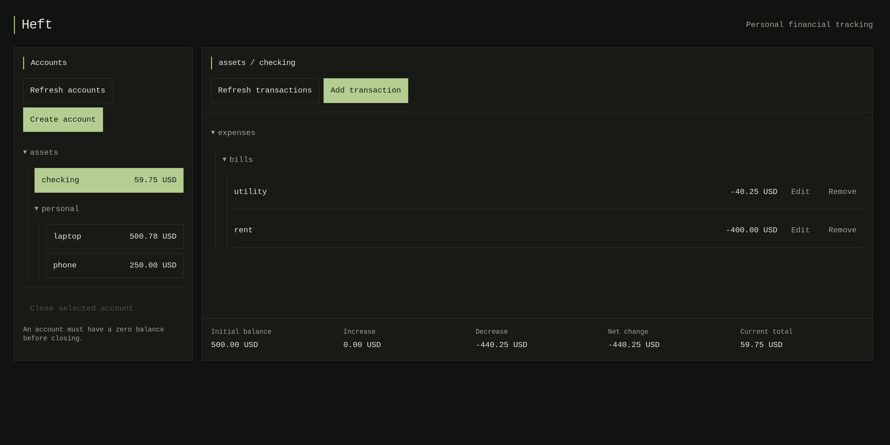

# heft
A pure app for managing your personal financial assets.

Built in *Haskell*, *Nix*, and *Elm*, for absolute purity.

# What?

**heft** is a simple, lightweight, and pure web app for managing your personal
financial assets.

It's designed to be easily self-hostable and secure if you do decide to
expose it to the public.

# Why?

While (likely even better) projects (like **hledger-web**) exist, I either
don't like that transactions have to be balanced or simply don't like their
UI.

# Note

This is a very experimental software, expect breaking changes without notice.

## hledger import/export

`Database.Ledger` provides `exportHledger connection username` and
`importHledger connection username journalText`, returning `Either Text` results.
Conversion is best effort: usable data is kept, unsupported data is skipped,
and missing information is inferred where possible. The function signatures
are unchanged; a successful result can contain only part of the source data.

Exports use two regular postings per transaction:

```journal
1970-01-01 (heft) App opening balance
    assets:Checking  100.00 USD
    equity:opening-balances  -100.00 USD

2026-10-21 (heft) Groceries
    ; app-timestamp: 1792584000
    assets:Checking  -12.50 USD
    equity:unclassified  12.50 USD
```

### Import

- Each usable regular `assets:` posting becomes a Heft account movement, with
  the prefix removed from its account name. Split transactions and transfers
  can produce multiple movements. Other accounts can have any name; their
  postings are used for inference but are not stored.
- hledger attempts to infer omitted amounts independently for each transaction.
  If inference or balancing fails, explicit usable asset amounts are still
  imported; unresolved amounts are skipped.
- A regular `equity:opening-balances` posting marks an opening entry. Its asset
  amounts accumulate into initial balances. An opening amount that would
  overflow is skipped. Accounts without opening entries start at zero.
- Each account keeps its first usable commodity. Later amounts in conflicting
  commodities are skipped. Amounts with fractional cents, values outside
  SQLite's signed 64-bit range, invalid account names or commodities, and virtual
  postings are skipped independently of the other postings.
- Native commodity quantities are retained from costed amounts; cost and lot
  annotations are discarded. No currency conversion or rounding is performed.
- Posting-specific dates take precedence over transaction dates. A single valid
  `app-timestamp` tag preserves Unix seconds if it matches that date. Missing,
  invalid, duplicate, overflowing, or mismatched tags fall back to UTC midnight.
  Dates outside years 1–9999 are skipped.
- Empty descriptions become `Imported transaction`. Codes, statuses, assertions,
  prices, automated/periodic transaction rules, and other metadata are not stored.
  Account declarations alone do not create accounts without a usable amount.

Import still replaces that user's financial data atomically with the usable
subset, including an empty ledger if no usable postings remain. Journal syntax
errors that prevent parsing, missing users, and database failures return an error;
the existing data is preserved on failure.

### Export

- Invalid accounts and their transactions are skipped. For duplicate account
  names, the first representable account by database ID is kept.
- Transactions with invalid descriptions, dates outside years 1–9999, or missing
  or skipped accounts are skipped. Other accounts and transactions are exported.
- Each exported account gets an opening balance entry, including zero balances,
  to preserve empty accounts. Normal movements balance against
  `equity:unclassified` and retain their exact `app-timestamp`.
- The exported `(heft)` code keeps descriptions from being parsed as header
  syntax. An export with no usable rows succeeds with an empty journal.

